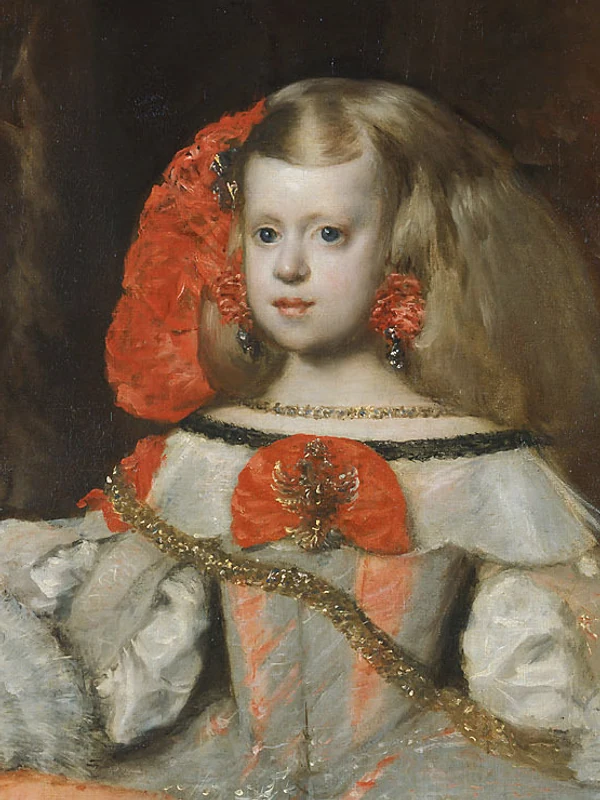
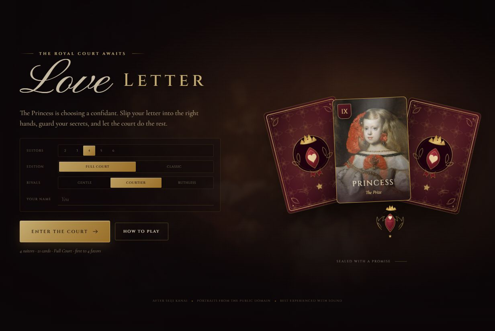
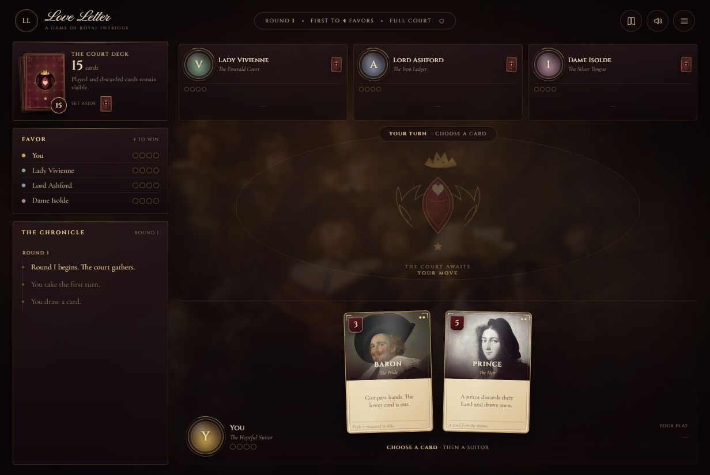
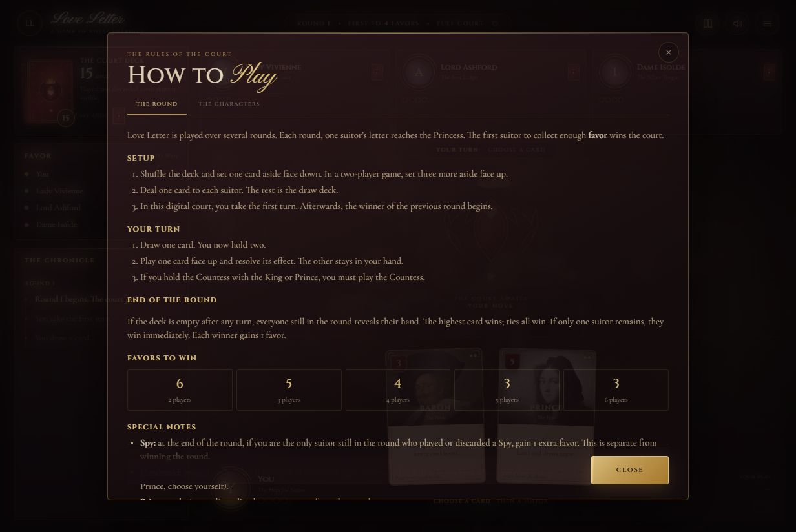

# Love Letter

A polished, single-player digital edition of **Love Letter** — the game of royal intrigue by Seiji Kanai. Slip your letter into the right hands, read the court, and earn the Princess's favor before your rivals do.



## Play

```bash
npm start
```

Open **http://127.0.0.1:5173** and click **Enter the Court**.

No build step, no dependencies, no network requests after page load. A tiny zero-dependency Node server serves the static game.

```bash
npm test
```

runs the rules-engine and AI simulation test suite (25 tests).

## Screenshots

| Title screen | Gameplay |
| --- | --- |
|  |  |



## What's inside

- **Complete 2025 rules** — 2–6 suitors, 21 cards, including the **Chancellor** and **Spy**.
- **Classic edition** — 2–4 players with 1 Guard, both Chancellors, and both Spies removed.
- **All 10 characters** with their full effects: Guard, Priest, Baron, Handmaid, Prince, Chancellor, King, Countess, Princess, and Spy.
- **Proper favor targets** — 6 / 5 / 4 / 3 / 3 favors for 2–6 players.
- **A court of AI rivals** in three temperaments: Gentle, Courtier, and Ruthless. The AI reasons from public card counts and only sees its own hand.
- **Six suited courts** with distinct rival names and heraldic medallions.
- **Snappy turn presentation** — draw, play, target, reveal, eliminate, and score with staged effects and a readable chronicle.
- **Thematic interface** — baroque public-domain portraits, wax-seal favor tokens, a hand-illustrated card back, procedural Web Audio music and effects, and a responsive table for desktop and mobile.
- **Full rules reference** and an in-game menu/settings panel.
- **No hidden-information leaks in the AI view**; the human is the only player whose hand the interface renders.

## Rules at a glance

Each round:

1. Shuffle the deck, set one card aside face down (and three more face up in a two-player game), then deal one card to each suitor.
2. On your turn, draw one card and play one of your two cards.
3. Resolve the card's effect. Played and discarded cards stay face up.
4. The round ends when the deck is empty (highest hand wins; ties all win) or when only one suitor remains.
5. Winners gain one favor. The sole surviving suitor who played or discarded a **Spy** gains one extra favor.
6. The first suitor to collect the target number of favors wins the Princess's confidence. Multiple suitors can win together.

If you hold the **Countess** with the **King** or **Prince**, you must play the Countess. The **Princess** removes you from the round if played or discarded.

## Project structure

```
index.html            page shell, title screen, icon sprite
styles.css            the entire visual system and responsive layout
server.js             zero-dependency static file server
src/rules.js          pure, testable rules engine (2025 + classic editions)
src/ai.js             probability-driven court AI and Chancellor logic
src/audio.js          procedural Web Audio sound effects and ambient music
src/main.js           game flow, rendering, interaction, and modals
tests/rules.test.js   setup, effects, round end, scoring, edge cases
tests/ai.test.js      AI choices and full-game simulation across all player counts
assets/               public-domain portraits, card back/crest SVGs, bundled fonts
```

The deck is stored bottom-first in the engine; the top card is the last element. The engine emits events that the UI stages into effects, toasts, and reveals. The AI receives a sanitized player view with only public information.

## Art & type credits

The character portraits are public-domain paintings sourced from Wikimedia Commons:

- **Princess** — after Diego Velázquez, *Infanta Margarita Teresa*
- **Countess** — Agnolo Bronzino, *Portrait of Lucrezia Panciatichi*
- **King** — Hyacinthe Rigaud, *Portrait of Louis XIV*
- **Chancellor** — Hans Holbein the Younger, *Portrait of Erasmus*
- **Prince** — Raphael, *Portrait of a Young Man*
- **Handmaid** — Johannes Vermeer, *Young Woman with a Water Pitcher*
- **Baron** — Frans Hals, *The Laughing Cavalier*
- **Priest** — El Greco, *Portrait of a Cardinal*
- **Guard** — Rembrandt van Rijn, *The Standard Bearer*
- **Spy** — Caravaggio, *The Cardsharps*
- Background texture — Rembrandt van Rijn, *The Night Watch* (heavily blurred and darkened)

The card back, crest, and damask pattern are original SVGs. The bundled typefaces are **Cinzel**, **Cormorant Garamond**, and **Pinyon Script**, all under the SIL Open Font License via Google Fonts.

**Love Letter** is designed by Seiji Kanai and published by Z-Man Games. This is a free, non-commercial digital tribute and is not affiliated with or endorsed by Z-Man Games or the designer. All rules are implemented for personal play.
